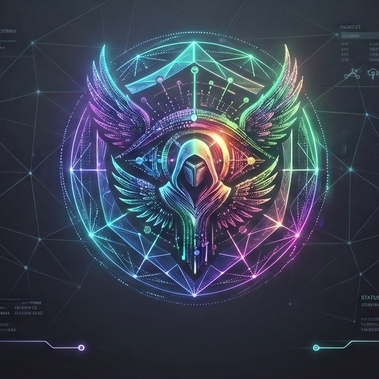
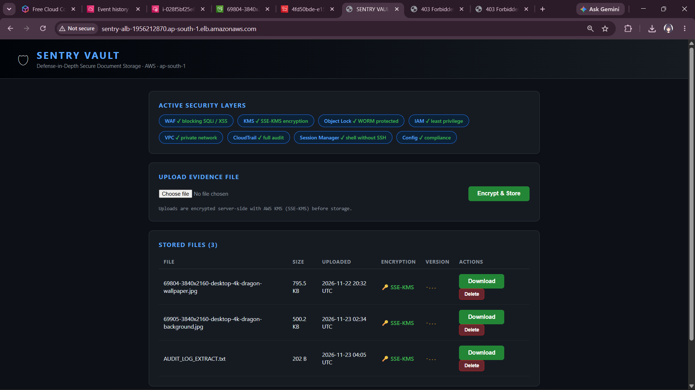
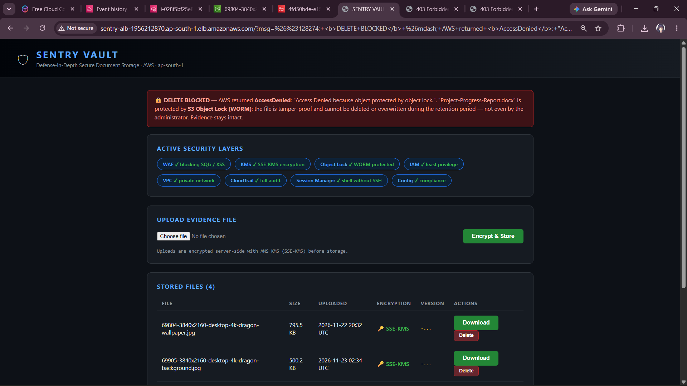
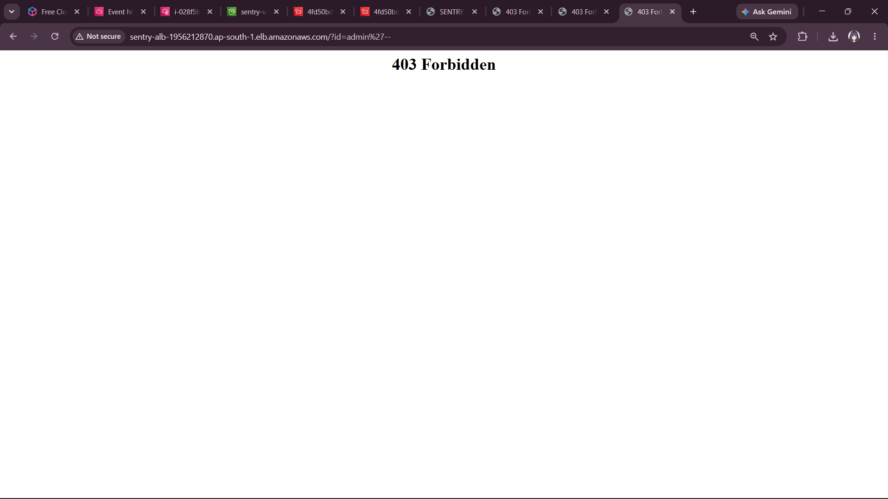
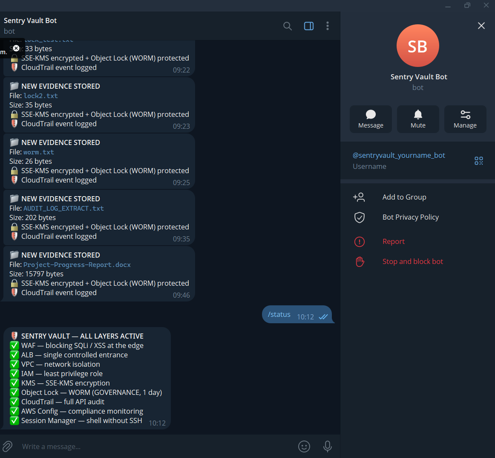

<p align="center">
  
</p>

<h1 align="center">🛡️ SENTRY VAULT</h1>

<p align="center">
  <b>Defense-in-Depth Secure Document Storage on AWS</b><br>
  <i>Upload evidence. AWS encrypts it, freezes it, and refuses to let anyone - even the administrator - destroy it.</i>
</p>

<p align="center">
  
  
  
  
  
</p>

> 📌 **Status:** built, live-demonstrated, and torn down (November 2026) as a Cloud Security & Forensics academic project. The walkthrough below reproduces it on any AWS account in ~15 minutes.

---

## 🚨 The Case: Why This Project Exists

Digital evidence held by **government agencies and law enforcement** faces a brutal reality. Consider a cyber-crime unit that seizes a phone and extracts evidence photos. Between seizure and trial - which can take **years** - that evidence is exposed to:

| Real-world threat | Consequence |
|---|---|
| 🦠 **Ransomware** | Modern ransomware deletes backups *first*, then encrypts everything - recovery becomes impossible |
| 🕵️ **Hackers** | Attackers breach storage servers and destroy or alter evidence to collapse the case |
| 👤 **Insider threat** | A single corrupt administrator quietly deletes one photo - an innocent person is framed |
| ⚖️ **Court challenge** | "Could anyone have modified this evidence?" - if you can't prove it technically, the evidence loses value |
| 🤦 **Accidents** | One wrong command wipes years of investigation |

**Traditional storage cannot answer the court's one decisive question:**

> *"Can you prove, technically, that nobody could have altered or removed this evidence?"*

**SENTRY VAULT is the answer: YES - architecturally.** Once a file enters the vault, destruction becomes impossible - not by a hacker, not by malware, not even by the administrator - and every single interaction is permanently recorded. The same pattern protects hospital records, bank audit logs, legal contracts, and enterprise ransomware-proof backups (S3 Object Lock is exactly the feature enterprise backup products use).

## 🖥️ The System

A web application backed by **15 AWS services** arranged as a defense-in-depth stack. Every layer assumes the previous one failed:

```text
 USER (HTTPS)
    │
    ▼
┌─────────────────┐
│  WAF  +  ALB    │  ← attacks die here (SQLi/XSS → 403 in <50 ms)
└─────────────────┘
    │ only valid traffic
    ▼
┌──────────────────────────────────────┐
│  VPC  10.0.0.0/16 (private network)   │
│                                        │
│   EC2 Flask App ──assumes──▶ IAM Role │
│        │            (least privilege)│
│    put/get │                           │
│        ▼    │ GenerateDataKey/Decrypt │
│   S3 VAULT ◀────── KMS KEY            │
│   🔒 SSE-KMS + Versioning             │
│   🔒 OBJECT LOCK (WORM)               │
└──────────────────────────────────────┘
    │                 │              │
    ▼                 ▼              ▼
 CloudTrail      AWS Config    Lambda → Telegram
 (audit)         (compliance)  (real-time alerts)
```

## 🖼️ Live Demo Proof

**The application** - every file stored is encrypted and locked:



**Deleting evidence is refused by AWS itself** - even though the application has full delete permissions in its IAM policy:



**Attacking the application** - a real SQL injection payload is blocked at the edge:



**Real-time alerts to the owner's phone:**



## 🔒 Security Layers - Each One Proven Live

| # | Layer | Service | Live proof from the demo |
|---|---|---|---|
| 1 | Edge firewall | **WAF** (managed SQLi + Common rules) | SQLi payload → `403 Forbidden` in <50 ms; XSS → 403 |
| 2 | Single entrance | **ALB** | Only public path; health-checked; WAF attachment point |
| 3 | Network isolation | **VPC** + Security Groups | Direct access to server IP fails; **no SSH port exists** |
| 4 | Least privilege | **IAM** role | Server reads its own vault ✅; `list-buckets` → `AccessDenied` ❌ |
| 5 | Encryption at rest | **KMS** (SSE-KMS) | Objects show `aws:kms`; key auto-rotates; every use logged |
| 6 | Immutability | **S3 Versioning + Object Lock (WORM)** | `DeleteObject` on locked version → `AccessDenied: object protected by object lock` |
| 7 | Forensic audit | **CloudTrail** (management + data events) | Raw logs capture every upload/delete attempt with exact IAM identity |
| 8 | Continuous compliance | **AWS Config** | Rule `bucket-not-public` → `COMPLIANT` |
| 9 | Real-time alerting | **Lambda + Telegram** | `🚨 TAMPER ATTEMPT BLOCKED` reaches the owner's phone in seconds |
| 10 | Cost governance | **Budgets** | $1 monthly alarm, email at 80% |

## ⚙️ Services Used (15)

| Service | Role | Why it's there |
|---|---|---|
| **EC2** (t3.micro) | Hosts the Flask app | Compute inside a controlled network |
| **VPC + Subnets** | Private network 10.0.0.0/16, 2 AZs | Network isolation |
| **S3** | Evidence vault | Durable encrypted object storage |
| **S3 Versioning + Object Lock** | Keeps every version, freezes them | Tamper-proof immutability (WORM) |
| **KMS** | Customer-managed key `sentry-vault` | Encryption at rest + audited key use + rotation |
| **IAM** | Least-privilege instance role | Contain the blast radius |
| **ALB** | Single public entrance | No direct server exposure |
| **WAF v2** | Managed SQLi + Common rules | Edge attack blocking |
| **CloudTrail** | Management + data event logging | Complete forensic audit trail |
| **AWS Config** | Continuous rule evaluation | Configuration drift detection |
| **Lambda** | Telegram bot (serverless) | Real-time alerting with zero servers |
| **Session Manager** | Shell without SSH | Zero management ports, logged sessions |
| **CloudFormation** | Everything as one YAML template | Infrastructure as Code |
| **Budgets** | $1 monthly alarm | Cost governance |
| **CloudWatch** | Metrics | Operational visibility |

---

## ⚙️ Setup (Windows / Linux / macOS)

Everything runs from a terminal. On **Windows**, use **Git Bash** (installed automatically with Git) or WSL - the same commands work everywhere.

### Step 0 - Prerequisites

| Requirement | Windows | Linux | macOS |
|---|---|---|---|
| AWS CLI v2 | `winget install Amazon.AWSCLI` | [Install guide](https://docs.aws.amazon.com/cli/latest/userguide/getting-started-install.html) | `brew install awscli` |
| Python 3.10+ | `winget install Python.Python.3.12` | usually preinstalled | preinstalled / `brew install python` |
| Git (+ Git Bash on Windows) | `winget install Git.Git` | `apt install git` | `brew install git` |
| AWS account | [Free Tier](https://aws.amazon.com/free/) - the project fits inside it | | |
| Optional: Telegram bot token | Message [@BotFather](https://t.me/BotFather) `/newbot`, then message your bot once | | |

> 💡 All commands below also work with an **AWS named profile**: add `--profile <name>` or `export AWS_PROFILE=<name>`.

### Step 1 - Configure AWS credentials

```bash
aws configure --profile sentry
#   AWS Access Key ID:     <your key>
#   AWS Secret Access Key: <your secret>
#   Default region name:   ap-south-1
```

Verify:

```bash
export AWS_PROFILE=sentry          # Git Bash / Linux / macOS
aws sts get-caller-identity        # should print your account ARN
```

### Step 2 - Clone and build the deployment template

```bash
git clone https://github.com/YAMRAJ13y/sentry-vault-aws.git
cd sentry-vault-aws
python infra/build_and_deploy.py    # injects the Flask app into the EC2 userdata
```

### Step 3 - Deploy the core stack (~10 minutes)

```bash
aws cloudformation deploy \
  --profile sentry \
  --template-file infra/sentry-deploy.yaml \
  --stack-name sentry-vault \
  --capabilities CAPABILITY_NAMED_IAM
```

**Optional - phone-side tamper alerts from the app itself** (requires a Telegram bot token, see Step 5):

```bash
aws cloudformation deploy \
  --profile sentry \
  --template-file infra/sentry-deploy.yaml \
  --stack-name sentry-vault \
  --capabilities CAPABILITY_NAMED_IAM \
  --parameter-overrides TelegramToken="123456:ABC-your-token" TelegramChatId="123456789"
```

This creates **~26 resources**: VPC + 2 subnets, EC2 + Flask app, S3 vault bucket (Versioning + Object Lock), KMS key, least-privilege IAM role, ALB, WAF (managed SQLi/XSS rules), CloudTrail bucket, Config role, SSM. The **WebsiteURL** appears in the stack Outputs.

### Step 4 - One-shot post-deployment

```bash
bash infra/post_deploy.sh your-email@example.com
```

This single script configures everything else: S3 Object Lock retention, the canonical CloudTrail trail + data events, AWS Config (role, recorder, delivery, compliance rule), and the $1 budget alarm.

**With the Telegram bot** (upload + tamper alerts to your phone):

```bash
export TELEGRAM_BOT_TOKEN="123456:ABC-your-token"
export TELEGRAM_CHAT_ID="123456789"
bash infra/post_deploy.sh your-email@example.com
```

That builds the serverless Lambda function, the secured webhook (secret-token verified), the S3 upload event trigger, and wires everything together.

> ℹ️ The script auto-detects your account ID and region, is idempotent, and skips sections gracefully if a service is restricted on your account plan.

### Step 5 - Verify the deployment

1. Open `WebsiteURL` from the stack Outputs → the dashboard loads
2. Upload a file → green banner; the S3 object shows `SSE-KMS` + Object Lock
3. Click **Delete** → red banner: *DELETE BLOCKED by object lock*
4. Visit `WebsiteURL/?id=admin'--` → `403 Forbidden` (WAF blocked SQLi)
5. Telegram `/status` → the bot lists every active security layer
6. CloudTrail Event history → filter Event source `kms.amazonaws.com` → your `GenerateDataKey` event

### Step 6 - Teardown when finished (important - ALB/WAF bill hourly)

```bash
# 1. empty the vault bucket (Object Lock holds versions for 1 day - bypass as admin)
# 2. then delete the stack and standalone resources:
aws cloudformation delete-stack --stack-name sentry-vault
aws cloudtrail delete-trail --name sentry-trail
aws lambda delete-function --function-name sentry-telegram-bot
```

> 📖 Full click-by-click walkthrough with expected outputs: [docs/deployment-guide.md](docs/deployment-guide.md)

---

## 🎭 Live Demo Walkthrough (what to show people)

| Step | Action | Visible result |
|---|---|---|
| 1 | Open the website | Dark security dashboard, 9 glowing layer badges |
| 2 | Upload a file | Green banner: *encrypted with KMS and stored securely* |
| 3 | Click **Delete** | 🔴 **DELETE BLOCKED** - AWS refuses; evidence intact |
| 4 | SQLi payload in URL | ⚡ **403 Forbidden** in <50 ms |
| 5 | Open CloudTrail | Every action recorded with identity + timestamp |
| 6 | Open Config | Rule status: **COMPLIANT** |
| 7 | Telegram `/status` | Bot lists all active security layers |

**Raw forensics:** the vault itself contains `AUDIT_LOG_EXTRACT.txt` - a human-readable extract of the raw CloudTrail log showing every upload and tamper attempt, timestamped and attributed to the exact IAM role.

---

## 📁 Project Structure

```text
sentry-vault/
├── app/
│   └── app.py                # Flask web app (upload / download / tamper-demo UI)
├── bot/
│   └── lambda_function.py   # Telegram bot + S3 event alerting (serverless)
├── docs/
│   ├── architecture.png     # Defense-in-depth architecture diagram
│   ├── screenshots/           # Real screenshots from the live demo
│   ├── deployment-guide.md  # Click-by-click deployment walkthrough
│   └── security-faq.md      # Design-decision Q&A (defense-in-depth, WORM, KMS...)
├── infra/
│   ├── sentry-vault.yaml    # Full CloudFormation template
│   ├── build_and_deploy.py  # Template builder (injects app into userdata)
│   └── post_deploy.sh        # One-shot post-deploy (all platforms)
├── assets/
│   └── logo.png              # Project logo
├── LICENSE
└── README.md
```

---

## 🔐 Security Design Notes

- **Governance vs Compliance lock:** this project uses **GOVERNANCE** mode (1-day retention) so cleanup stays possible. For real legal evidence, switch to **COMPLIANCE** mode - then *no one*, including the AWS root account, can delete until retention expires.
- **Two independent alert paths:** the app alerts on events, AND the S3 storage layer triggers Lambda directly. Compromising the application cannot silence the vault.
- **Webhook security:** the Telegram webhook is protected with a secret-token header - only Telegram can invoke the Lambda.
- **No secrets in code:** the app and bot read credentials from IAM roles / environment variables. Nothing is hardcoded.
- **Known tuning decision:** WAF's `SizeRestrictions_BODY` managed rule (blocks bodies >8 KB) is set to Count mode so legitimate evidence files pass - every other rule still blocks. Security controls must be tuned to the application.

## 🔮 Future Scope

- HTTPS/TLS via ACM certificate + registered domain
- User authentication with **Amazon Cognito** (MFA-protected)
- Automated incident response: **GuardDuty → EventBridge → Lambda** isolating compromised instances
- **AWS Security Hub** centralized compliance scoring
- **CloudTrail + Athena**: SQL queries over audit logs
- Auto-scaling across Availability Zones

## 🤝 Contributing

Issues and pull requests are welcome. For significant changes, open an issue first to discuss the approach.

## 📜 License

[MIT](LICENSE) - built as a Cloud Security & Forensics academic project by [Sumit Solanki](https://github.com/YAMRAJ13y).
