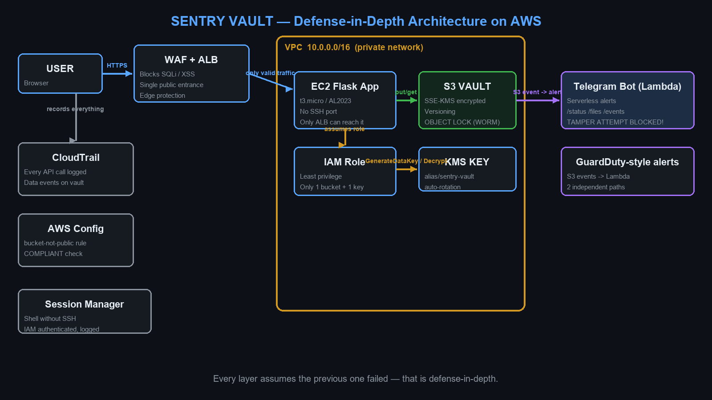

# 🛡️ SENTRY VAULT

> **Defense-in-Depth Secure Document Storage on AWS**
> Upload evidence. AWS encrypts it, freezes it, and refuses to let anyone - even the administrator - destroy it. Every action is audited, and your phone gets alerted in real time.


## 🎯 What is this?

A working, live-demoed **immutable evidence vault** built with 15 AWS services. Once a file enters the vault:

- ✅ It is **encrypted at rest** with a dedicated customer-managed KMS key
- ✅ It becomes **tamper-proof** - S3 Object Lock (WORM) refuses deletion *even with full delete permissions*
- ✅ Attacks are **blocked at the edge** - WAF managed rules return 403 in <50 ms
- ✅ Every action is **recorded forensically** (CloudTrail, including object-level data events)
- ✅ Your **phone is alerted in real time** via a serverless Telegram bot (Lambda)
- ✅ Compliance is **continuously verified** (AWS Config)

The application deliberately holds full delete permissions - so when deletion fails, it proves the guarantee comes from **AWS storage internals, not from a missing permission**.

## 🏗️ Architecture



**Traffic flow:** User → WAF (blocks attacks) → ALB (single entrance) → EC2 Flask app inside a private VPC (reachable only from the ALB, no SSH) → IAM role (least privilege) → S3 vault (KMS + Versioning + Object Lock). CloudTrail and Config audit everything; S3 events trigger a Lambda-powered Telegram bot for real-time alerts.

## 🔒 Security layers demonstrated

| Layer | Service | Live-proof |
|---|---|---|
| Edge firewall | AWS WAF (managed SQLi + Common rules) | SQLi payload → `403 Forbidden` in <50 ms |
| Network isolation | VPC + Security Groups | Direct access to server IP fails; no SSH port exists |
| Least privilege | IAM role | Server can read its own vault; `list-buckets` → `AccessDenied` |
| Encryption at rest | KMS (SSE-KMS) | Object metadata shows `aws:kms`; GenerateDataKey/Decrypt logged |
| Immutability | S3 Versioning + Object Lock (GOVERNANCE) | Delete attempt → `AccessDenied: object protected by object lock` |
| Audit | CloudTrail (management + data events) | Raw logs capture every PutObject/DeleteObject attempt with identity |
| Compliance | AWS Config | Rule `bucket-not-public` → COMPLIANT |
| Alerting | Lambda + Telegram | Real-time "TAMPER ATTEMPT BLOCKED" / "NEW EVIDENCE STORED" |
| Cost control | Budgets | $1 monthly alarm, email at 80% |

## 📁 Repository structure

```
sentry-vault/
├── app/
│   └── app.py               # Flask web app (upload, download, tamper demo UI)
├── bot/
│   └── lambda_function.py   # Telegram bot + S3 event alerting (AWS Lambda)
├── docs/
│   ├── architecture.png     # Defense-in-depth architecture diagram
│   ├── deployment-guide.md  # Step-by-step deployment walkthrough
│   └── security-faq.md      # Viva/interview Q&A on every design decision
├── infra/
│   ├── sentry-vault.yaml    # Full CloudFormation template (all resources)
│   ├── build_and_deploy.py  # Injects app code into userdata, builds deploy template
│   └── post_deploy.sh       # Object Lock config, CloudTrail, Config rule, budget
├── LICENSE
└── README.md
```

## 🚀 Deploy it yourself

**Prerequisites:** an AWS account, AWS CLI v2 configured (`aws configure`), and [Telegram BotFather](https://t.me/BotFather) bot token.

```bash
# 1. Build the deployment template (injects the app into EC2 userdata)
python infra/build_and_deploy.py

# 2. Deploy everything (VPC, EC2, S3, KMS, IAM, ALB, WAF, CloudTrail, Config)
aws cloudformation deploy \
  --template-file infra/sentry-deploy.yaml \
  --stack-name sentry-vault \
  --capabilities CAPABILITY_NAMED_IAM

# 3. Post-deploy: Object Lock retention, CloudTrail, Config rule, budget, bot
bash infra/post_deploy.sh your-email@example.com

# 4. Open the ALB DNS name from the stack outputs - done.
```

Full walkthrough: [docs/deployment-guide.md](docs/deployment-guide.md)

### Telegram bot setup
1. Message [@BotFather](https://t.me/BotFather) → `/newbot` → copy the token
2. Message your new bot once (any text) → the chat ID appears in `getUpdates`
3. Put token + chat id into the Lambda environment variables (see deployment guide)
4. Point the Telegram webhook at the Lambda Function URL

## 🧪 Reproduce the live demo

| Action | Expected result |
|---|---|
| Open the ALB URL | Dark security dashboard |
| Upload a file | Green banner: *encrypted with KMS and stored securely* |
| Click Delete | Red banner: *DELETE BLOCKED - object protected by object lock* |
| `?id=admin'--` in the URL | `403 Forbidden` (WAF blocked SQLi) |
| `?q=<script>` in the URL | `403 Forbidden` (WAF blocked XSS) |
| Telegram `/status` | Bot lists all active security layers |

## 🧹 Teardown (important!)

WAF and ALB incur hourly charges. When finished:

```bash
# empty the vault bucket first (Object Lock may hold versions for 1 day)
aws s3 rm s3://sentry-vault-<ACCOUNT_ID> --recursive
aws cloudformation delete-stack --stack-name sentry-vault
aws lambda delete-function --function-name sentry-telegram-bot
```

## ⚠️ Security notes

- Built for **educational demonstration**. For production evidence handling: enable **Compliance-mode** Object Lock, add HTTPS via ACM, user auth via Cognito, and multi-factor deletion approvals.
- Governance-mode lock (used here) allows bypass by specially privileged principals; Compliance-mode allows no one.
- Never commit AWS keys. The app and bot read all credentials from their IAM roles / environment variables - no secrets are hardcoded anywhere in this repo.

## 📚 Learn more

See [docs/security-faq.md](docs/security-faq.md) for the reasoning behind every design decision (defense-in-depth, WORM modes, envelope encryption, data vs management events, WAF tuning, and more).

## 📜 License

MIT - see [LICENSE](LICENSE). Built as a Cloud Security & Forensics academic project.
